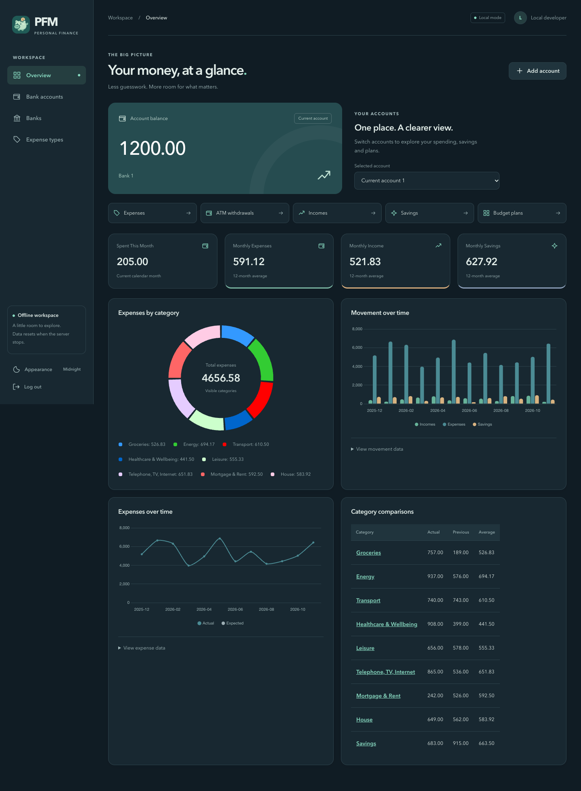

# Personal Finance Manager

PFM is a web application to manage your personal finance and visualise your expenses in a dashboard. 

## A clearer picture of your finances

The React workspace offers two themes, a refreshed piggy-bank identity,
interactive spending charts, and friendlier configuration forms.
Use [the website setup](./PFM.Website.Reboot/README.md) to run it with live
services or with offline demo data.

A video walkthrough is available
on the PFM Website page when you run the [Docusaurus documentation site](./docs/sites/docs/0003-Development/overview.md#documentation-site-development).

Check the documentation here:

- [Business Requirements](./docs/sites/docs/0001-Business%20Requirements/0000-overview.md)
- [System Design](./docs/sites/docs/0002-System%20Design/0000-overview.md)
- [Getting Started](./docs/sites/docs/0003-Development/overview.md)