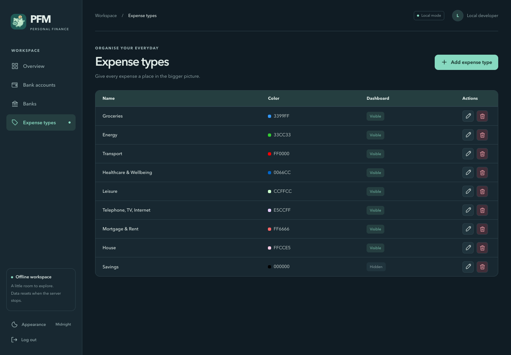

# Personal Finance Manager

PFM is a web application to manage your personal finance and visualise your expenses in a dashboard. 

## A clearer picture of your finances

The React workspace offers two themes, a refreshed piggy-bank identity,
interactive spending charts, and friendlier configuration forms.
Use [the website setup](./PFM.Website.Reboot/README.md) to run it with live
services or with offline demo data.

### Pearl

### Midnight

### Quick walkthrough

[Watch or download the 32-second walkthrough (WebM, about 3 MB)](./docs/sites/static/video/pfm-workspace.webm).
The documentation site's Getting Started page includes an inline player with
English captions. This repository-relative video link is provided because
GitHub README Markdown does not reliably embed repository video files inline.

All screenshots and the silent walkthrough use local offline demo data.
Historical Blazor screenshots remain in the business specifications.

Check the documentation here:

- [Business Requirements](./docs/sites/docs/0001-Business%20Requirements/0000-overview.md)
- [System Design](./docs/sites/docs/0002-System%20Design/0000-overview.md)
- [Getting Started](./docs/sites/docs/0003-Development/overview.md)