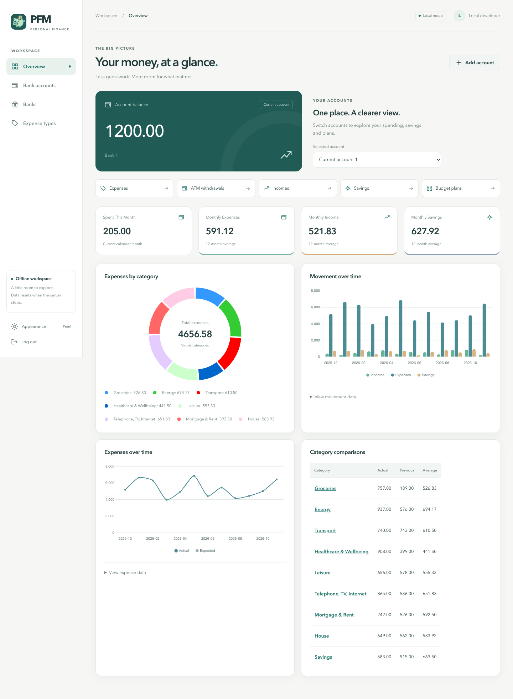
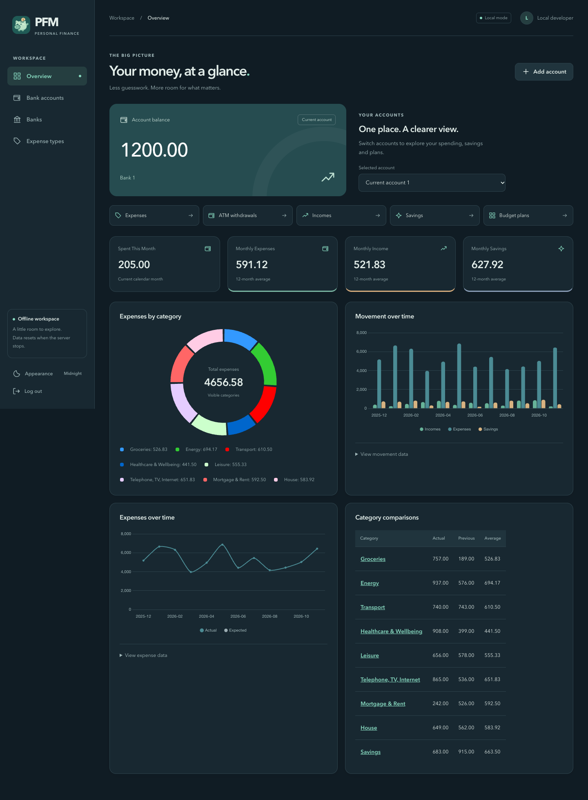

# PFM Website

import useBaseUrl from '@docusaurus/useBaseUrl';

PFM is a web application to manage your personal finance and visualise your expenses in a dashboard. 

## The React workspace

The offline React client offers two themes while preserving the existing
backend contracts. These captures show temporary local demo data; the
non-offline profiles still use the existing Blazor website.

### Pearl

### Midnight

## See it in action

This silent, captioned walkthrough covers the dashboard, theme switching,
configuration tables, category forms and safe deletion. No data is saved or
deleted during the tour.

<video
  controls
  playsInline
  preload="none"
  poster={useBaseUrl('/img/pfm/react-expense-types.png')}
  style={{width: '100%', borderRadius: '12px'}}
  aria-label="PFM workspace walkthrough"
>
  <source src={useBaseUrl('/video/pfm-workspace.webm')} type="video/webm" />
  <track default kind="captions" src={useBaseUrl('/video/pfm-workspace.en.vtt')} srcLang="en" label="English" />
  Your browser does not support embedded video.
</video>

<a href={useBaseUrl('/video/pfm-workspace.webm')}>Download the walkthrough</a> or follow the
[text walkthrough](./0003-Development/overview.md#workspace-walkthrough).

Historical specification screenshots are retained for reference. See the
[business requirements](./0001-Business%20Requirements/0000-overview.md).
