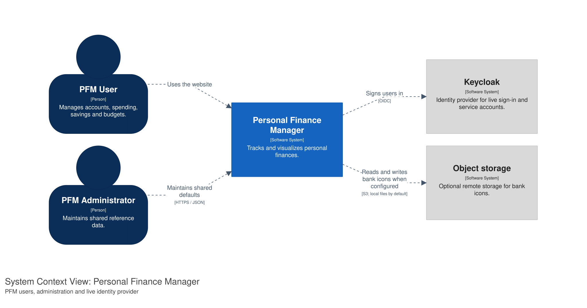
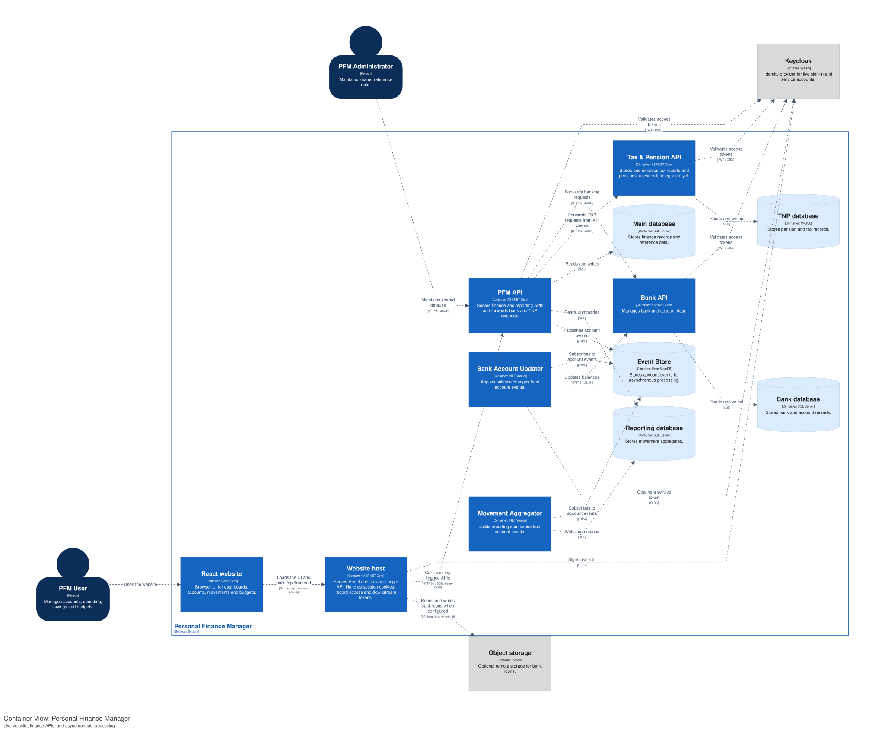
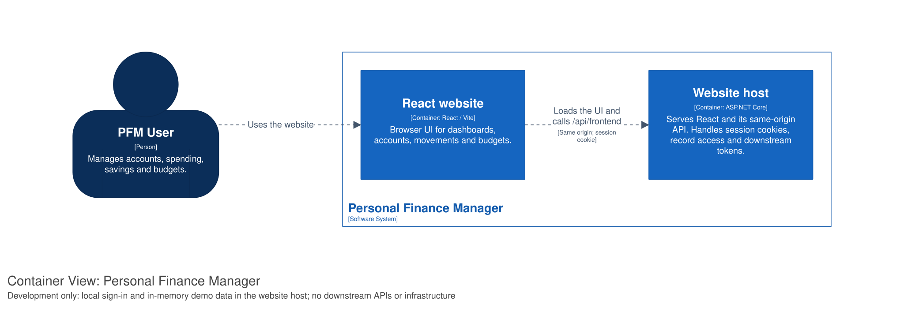

# Overview

## C4 system context

## Live containers

The website host keeps upstream tokens server-side. The Tax & Pension API
remains part of the backend, but React does not expose it.

## Offline containers

The offline profile signs users in locally without Keycloak, backend APIs, or
databases. The in-memory data is reset when the host stops.

The [React UI decision](./0002-react-offline-ui-adr.md) documents the contract
boundary. See [System Architecture Evolution](./system-evolution) for earlier
designs and the [regeneration instructions](../0003-Development/overview.md#regenerate-the-c4-diagrams)
to update these diagrams.