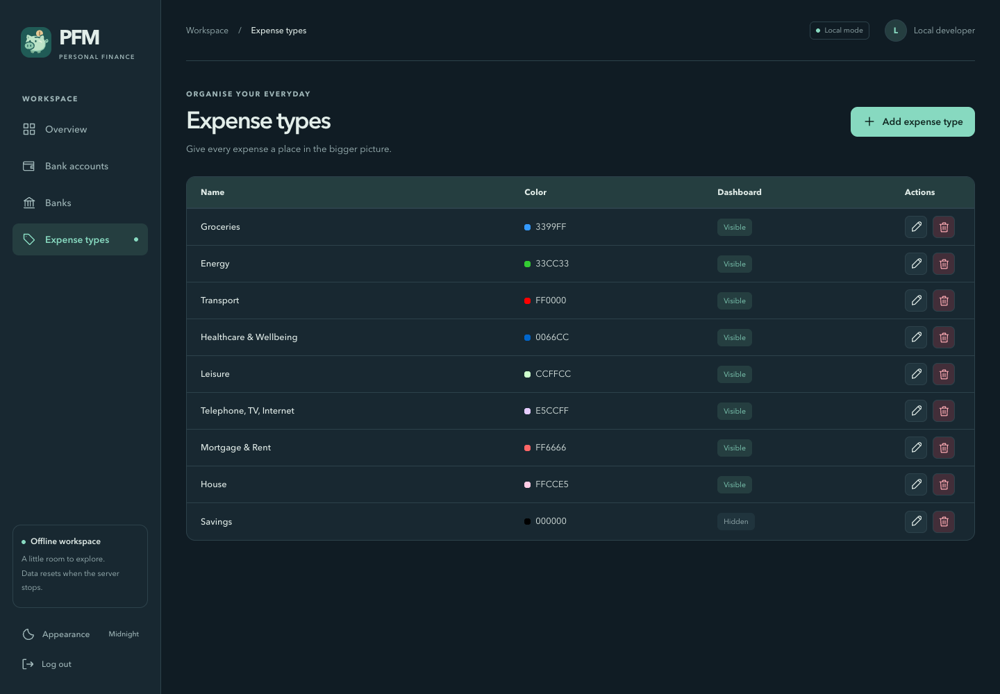
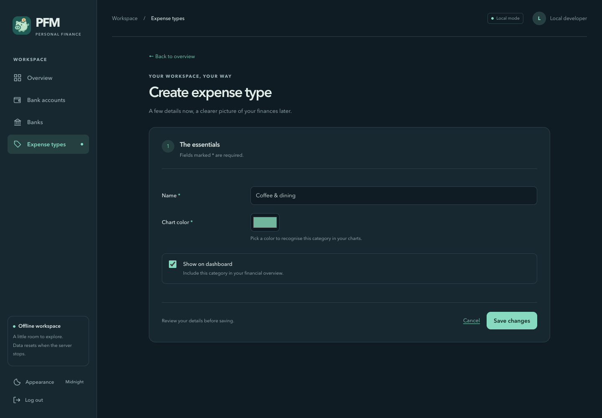
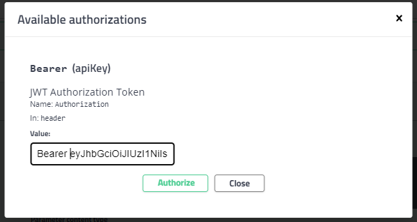

# Getting Started

import useBaseUrl from '@docusaurus/useBaseUrl';

### Pre-requisites

#### Tools

You will need the following tools installed on your development machine:
- [x] Docker
- [x] .NET 11
- [x] `jq` command line
- [x] `tilt` command line

#### Changes on hosts file

Add the following entries to your hosts file:

```sh
sudo sh -c 'echo 127.0.0.1 keycloak >> /etc/hosts'
```

#### GitHub Package Access

To run from local machine, you will need a GitHub token to access the private GitHub packages. 

In the `./PFM.Infra/configs`, you will find an .env-example file. If you copy this file and name it `.env` in the same location, the `tilt up` script will pick it up automatically. 

:warning: This file is part of gitignore. It will contains sensitive data, do not commit the .env file. 

#### Local keycloak secrets

To simplify the setup, the secrets for Keycloak have been hard-coded. In a normal setup, this would have to be stored in a secured fashion. 

| Property                 | Value                              | Description                              |
| ------------------------ | ---------------------------------- | ---------------------------------------- |
| admin                    | `SecurityMatters12456!`            | Administrator Password                   |
| jess                     | `SecurityMatters!123`              | PFM Default User                         |
| pfm                      | `RTkyA3RNh4cHHhS8ftXe17WOQu9a0Jjd` | App client for PFM Website               |
| pfm-bank-account-updater | `RTkyA3RNh4cHHhS8ftXe17WOQu9a0Jje` | Service account for Bank Account Updater |
| pfm-mvt-aggregator       | `RTkyA3RNh4cHHhS8ftXe17WOQu9a0Jjf` | Service account for Movement Aggregator  |

#### Shared infrastructure

Some infrastructure resources are shared accross different projects (e.g. SQL server, SEQ, AWS), some are dedicated to each apps (e.g. creation DB, a SQS queue). 

The shared resources available in the PFM.Infra folder, contains the shared resources:

| Resources        | Description                                                                                                      | Docker                                                                                       | Debug Mode                                                        | Internal Docker                     |
| ---------------- | ---------------------------------------------------------------------------------------------------------------- | -------------------------------------------------------------------------------------------- | ----------------------------------------------------------------- | ----------------------------------- |
| SEQ              | Logging                                                                                                          | [Log Ingest](http://localhost:5341)<br/>[UI](http://localhost:80)                            | [Log Ingest](http://localhost:5341)<br/>[UI](http://localhost:80) | [Log Ingest](http://seq:5341)       |
| SQL Server       | a single container is used for several isolated DB, to reduce the setup time, space and memory in local machine. | localhost,1433                                                                               | localhost,1433                                                    | db-server,1433                      |
| Localstack       | Localstack for mocking AWS resources.                                                                            | [Endpoints](http://localhost:4566)                                                           | [Endpoints](http://localhost:4566)                                | [Endpoints](http://localstack:4566) |
| EventStore       | Publishing/consuming events and auditing.                                                                        | [Endpoints](http://localhost:2113)                                                           | [Endpoints](http://localhost:2113/)                               | [Endpoints](http://eventstore:2113) |
| Keycloak         | Authentication & Authorisation server. The keycloak-init folder will setup the minimum user & clients.           | [Endpoints](http://localhost:8080)                                                           | [Endpoints](http://localhost:8080)                                | [Endpoints](http://keycloak:8080)   |
| MySql Server     | a single container is used for several isolated DB, to reduce the setup time, space and memory in local machine. | localhost,3306                                                                               | localhost,3306                                                    | mysql-db-server,3306                |
| Aspire Dashboard | Monitoring dashboard for logging, metrics and tracing.                                                           | [Dashboard](http://localhost:18888/structuredlogs) <br/> Telemetry Ingestion: localhost:4317 |                                                                   |                                     |

### Starting the backend services & dependencies

You can start all the backend services and dependencies using the command: 

```shell
tilt up
```

From there, you can start the main website from Visual Studio. 

For frontend development, the website can use in-memory storage instead of
calling PFM.API. The setting is
`ApplicationSettings:ExternalServiceSettings:PfmApiOptions:Enabled`.

#### Frontend-only development

The React frontend-only profile uses the website's in-memory .NET services and
does not start the backend APIs, Keycloak, or infrastructure. Install Node.js
and npm, then from the repository root run:

```shell
npm ci --prefix PFM.Website.Reboot/src/PFM.Website.Client
dotnet run --project PFM.Website.Reboot/src/PFM.Website/PFM.Website.csproj --launch-profile frontend-only
```

Open http://localhost:5110. The ASP.NET Core SPA proxy starts Vite on port
5174 and redirects the browser there. Select **Enter your workspace** to sign in as a local
developer without Keycloak. Data is lost when the website stops. Offline
authentication is restricted to the Development environment and must not be
used for a publicly accessible deployment. Live profiles serve the same
React app and sign in through Keycloak. Build the React client first for
local live development. Default `tilt up` also builds and starts the
`pfm-website` resource at <https://localhost:7143>; no separate Node or .NET
process is needed. To enable sign-in, copy the secret for the `pfm` client
from **Keycloak Admin Console → pfm realm → Clients → pfm → Credentials**.
Set `WEBSITE_OIDC_CLIENT_SECRET` in the git-ignored `PFM.Infra/configs/.env`,
then run `tilt trigger pfm-website` to apply it. The local website uses a
self-signed development certificate.

The website contacts Keycloak over Docker at `http://keycloak:8080/realms/pfm`.
Keycloak is reached from the browser at `http://localhost:8080/realms/pfm`;
the website explicitly trusts that configured public issuer while keeping
issuer validation enabled. In this split-host setup, the website reads the
user's identity from the validated ID token instead of calling Keycloak's
internal UserInfo endpoint with a public-issuer token.

The existing in-memory implementations have limitations: some stores use
separate seeded copies of related data, so newly created expense types may not
be usable when creating expenses. Closing an ATM
withdrawal is not implemented, and editing a budget does not update its
expected income or savings. These are existing offline-service limitations;
the React migration does not change the backend to address them.

Alternatively, after `npm ci`, use the existing Tilt configuration:

```shell
tilt up -- --offline
```

Select the `pfm-frontend-offline` resource and open its link. This mode does not
start the other Tilt resources. Port 5110 is the .NET host and port 5174 is
the React development server; both must be available.

To run the client tests, use `npm test --prefix PFM.Website.Reboot/src/PFM.Website.Client`.
With the offline website running, set `PFM_OFFLINE_URL=http://localhost:5174`
to include the in-memory integration test. The integration test creates and
modifies temporary in-memory data and uploads then removes a test bank icon.

#### React workspace appearance

Choose **Pearl** or **Midnight** under **Appearance**. The choice is saved
locally as `pfm-appearance`. The shared logo is `public/pfm-mark.svg`.

#### Frontend CI and dependency updates

- **Frontend CI:** Node.js 24; `npm ci`, `npm test`, `npm run build`.
  Runs on PRs, pushes to `main` and manual dispatch. No package token needed.
  Live offline integration tests are excluded.
- **.NET CI:** SDK 11; requires the Actions secret `PAT_READ_PACKAGES`
  (classic PAT with `read:packages` and access to PFM packages).
- **npm updates:** Dependabot checks the client and docs weekly, grouping
  React/React DOM and Docusaurus updates. No automerge is configured.
- **Other updates:** Dependabot handles NuGet, Docker and GitHub Actions.

#### Workspace walkthrough

32 seconds, offline demo data, English captions.

<video
  controls
  playsInline
  preload="none"
  poster={useBaseUrl('/img/pfm/react-expense-types.png')}
  style={{width: '100%', borderRadius: '12px'}}
  aria-label="PFM workspace walkthrough"
>
  <source src={useBaseUrl('/video/pfm-workspace.webm')} type="video/webm" />
  <track default kind="captions" src={useBaseUrl('/video/pfm-workspace.en.vtt')} srcLang="en" label="English" />
  Your browser does not support embedded video.
</video>

<a href={useBaseUrl('/video/pfm-workspace.webm')}>Download the video</a>.

**Text alternative:** Review balances and charts in **Overview**, switch themes
under **Appearance**, then browse configuration tables. **Add expense type**
sets a name, color and dashboard visibility. Deletion requires confirmation;
**Keep item** cancels. The tour saves and deletes nothing.

##### Configuration at a glance





##### On smaller screens


##### Refreshing these captures

Refresh `react-*.png`, `video/pfm-workspace.webm`, captions and the text
alternative together. Use offline demo data only; preserve historical
Blazor screenshots. Recording used temporary local
[Playwright](https://playwright.dev/docs/videos)
([license](https://github.com/microsoft/playwright/blob/main/LICENSE)) and Chrome,
not a project dependency.

#### Configurations

##### External Settings Configs

Configuration Sections: `ApplicationSettings:AuthOptions`

| Property    | Default Value                    | Configration      |
| ----------- | -------------------------------- | ----------------- |
| `Authority` | http://localhost:8080/realms/pfm | SSO Authority     |
| `ClientId`  | pfm                              | PFM Client ID     |
| `ClientId`  | RTkyA3RNh4cHHhS8ftXe17WOQu9a0Jjd | PFM Client Secret |

##### External Settings Configs

Configuration Sections: `ApplicationSettings:ExternalServiceSettings`

| Property                            | Default Value                  | Configration                                                                                                   |
| ----------------------------------- | ------------------------------ | -------------------------------------------------------------------------------------------------------------- |
| `PfmApiOptions:Enabled`             | false                          | If disabled, use in-memory storage                                                                             |
| `PfmApiOptions:EndpointUrl`         | https://localhost:4431/        | PFM API Docker Endpoint.                                                                                       |
| `BankIconSettings:UseRemoteStorage` | false                          | If disabled, use local system. We need to put metrics to measure latency and optimise before re-enabling this. |
| `BankIconSettings:Location`         | ./wwwroot/Resources/bank_icons | If UseRemoteStorage is enabled, use the s3 bucket name for the location: pfm-website-bank-icons                |
| `AwsRegion`                         | eu-west-2                      | If UseRemoteStorage is enabled, s3 bucket AWS region (localstack init setup)                                   |
| `AwsEndpointUrl`                    | http://localhost:4566          | If UseRemoteStorage is enabled, s3 bucket AWS endpoint url (localstack init setup)                             |

The API URLs can be found here:

| Resources          | Docker                                                                                               | Debug Mode                                                                                             | Internal Docker                                |
| ------------------ | ---------------------------------------------------------------------------------------------------- | ------------------------------------------------------------------------------------------------------ | ---------------------------------------------- |
| App - PFM.Api      | [Api Endpoints](https://localhost:4431/api)<br/>[Swagger](https://localhost:4431/swagger/index.html) | [Api Endpoints](https://localhost:7098/api)<br/>[Swagger](https://localhost:4431/swagger/index.html)   | [Api Endpoints](https://pfm-api:4431/api)      |
| App - PFM.Bank.Api | [Api Endpoints](https://localhost:7099/api)<br/>[Swagger](https://localhost:7099/swagger/index.html) | [Api Endpoints](https://localhost:50001/api)<br/>[Swagger](https://localhost:50001/swagger/index.html) | [Api Endpoints](http://pfm-bank-api:50001/api) |
| App - PFM.TNP.Api  | [Api Endpoints](https://localhost:7111/api)<br/>[Swagger](https://localhost:7111/swagger/index.html) | [Api Endpoints](https://localhost:50002/api)<br/>[Swagger](https://localhost:50002/swagger/index.html) | [Api Endpoints](http://pfm-bank-api:50002/api) |

### Debug the APIs

All APIs uses Swagger. You can generate a token using the user created during the initialisation script: 

```shell
curl -v -L -X POST "http://localhost:8080/realms/pfm/protocol/openid-connect/token" \
-H 'Content-Type: application/x-www-form-urlencoded' \
--data-urlencode 'client_id=pfm' \
--data-urlencode 'grant_type=password' \
--data-urlencode 'client_secret=RTkyA3RNh4cHHhS8ftXe17WOQu9a0Jjd' \
--data-urlencode 'scope=openid' \
--data-urlencode 'username=jess' \
--data-urlencode 'password=SecurityMatters!123' | jq .access_token
```

The bearer token generated can then be used in Swagger.

Click on the "Authorize" button at the top of the page, enter "Bearer ", copy the token and Authorize:



You can now access the actions.

### Generate some data

Some features of the system are only demo-able if there is some data. To generate some data, run the following script:

```shell
sh ./generate-data.sh
```
